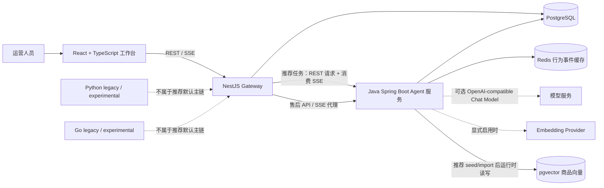
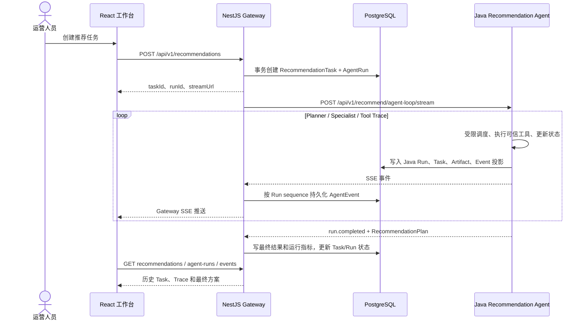
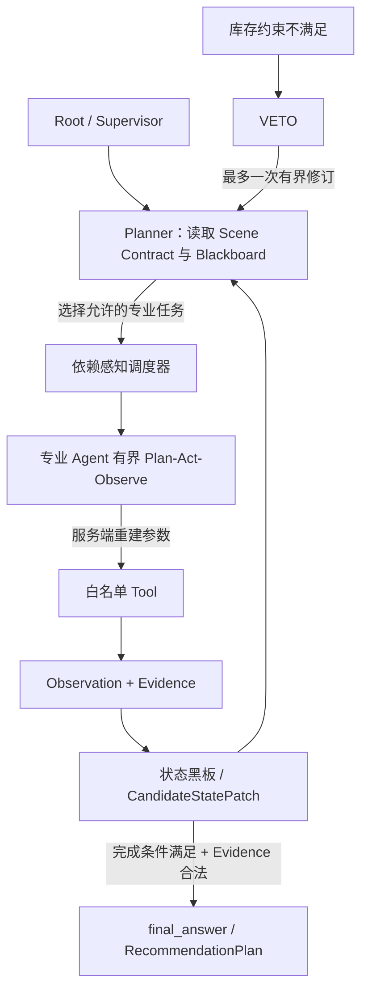
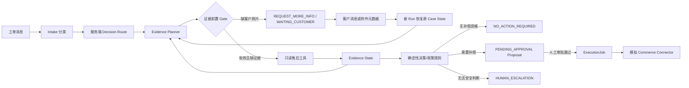

# 项目架构说明：电商可信业务 Agent 执行系统

> 这份文档按当前仓库源码编写。项目整体定位是电商可信业务 Agent 执行系统；当前主业务场景是跨境电商售后处置。推荐运营工作台是项目中的另一条已实现业务链路，属于辅助场景，不代表项目只有推荐，也不应把推荐说成当前唯一主业务。

## 1. 项目做什么

系统提供面向跨境电商运营人员的 Agent 工作台和服务端执行能力。它把模型的作用限制在识别、规划和受控内容生成等环节；订单、库存、政策、金额、权限、证据和外部副作用由服务端代码与数据源校验。

当前业务分为两部分：

| 场景 | 当前定位 | 主要能力 |
|---|---|---|
| 售后异常处置 | 主场景 | 工单分析、证据收集、政策匹配、补偿方案、人工审批、执行重试和审计 |
| 推荐运营工作台 | 辅助场景 | 创建 homepage / campaign / retention 任务，生成跨境商品推荐方案，查看 Agent Trace、历史运行和指标 |

Python 和 Go 目录保留旧版或实验性实现。推荐运营工作台的默认任务链由 Java Spring Boot 执行；Gateway 中仍有 Python legacy client，但推荐任务服务不走该路径。

项目适合用于演示 Agent 的受限执行、业务校验、多角色协作和可观测链路。它连接本地 PostgreSQL、Redis 和演示数据，不等于已接入真实电商生产系统。

## 2. 整体架构



| 部件 | 职责 | 当前实现边界 |
|---|---|---|
| React、TypeScript、Vite、Ant Design | Dashboard、推荐任务、Run Trace、商品/订单和售后工作台；调用 Gateway REST API，使用 EventSource 订阅运行事件 | 浏览器不直连 Java 数据库或模型服务 |
| NestJS Gateway | `/api/v1` API、认证与角色校验、任务/Run 运营接口、Prisma 持久化、Java 服务调用、SSE 转发 | 是业务入口和运营数据层，不负责推荐 Agent 的规划与商品选择 |
| Java Spring Boot 3.4、Spring AI | 推荐受限多 Agent Runtime、售后 Agent Loop、数据访问、规则校验、SSE 事件和运行时审计 | 推荐默认执行服务；模型及 Embedding 调用均需显式启用 |
| PostgreSQL | Gateway 的 Task、AgentRun、AgentEvent 等运营数据；Java 的 users、products、inventory、orders、user_events 及推荐运行时记录 | Compose 使用 PostgreSQL；Java 单独启动时 `application.yml` 默认可用 H2，不能据此误认为 Docker 主链用 H2 |
| Redis | 保存短期用户行为事件列表，供画像流程读取；事件也写入 PostgreSQL 作为持久记录 | Redis 不存商品主档、订单主档或 Agent Run 主记录；Redis 不可用时有本地 Caffeine / PostgreSQL / 请求上下文回退 |
| pgvector | 在市场过滤后的商品候选中执行 cosine distance 语义排序 | 支持真实 Embedding 路径，但默认离线配置下不会调用模型或生成真实向量 |
| Docker Compose | 启动 PostgreSQL/pgvector、Redis、Java、Gateway、前端及独立 Python legacy 服务 | 面向本地演示；默认账号、密钥和认证配置不应直接用于生产 |

Java 的运行时监听 `8080`，Gateway 默认 `3000`，前端 `5173`，PostgreSQL `5432`，Redis `6379`，Python legacy 服务 `8000`。Compose 将服务端口绑定在 loopback 地址，方便本机开发。

## 3. 推荐运营工作台

### 3.1 一次任务的主链



Gateway 的推荐任务服务在 `POST /api/v1/recommendations` 中创建 Task 和 Run，然后异步请求 `JAVA_AGENT_SERVICE_BASE_URL` 指向的 Java 服务。请求携带同一个 `runId`、业务场景、目标市场和运行配置。默认路径不是 Python `:8000`。

Java 侧还有同步推荐、Agent Loop、Tool Loop、SSE 和固定基线等接口。运营工作台创建的推荐 Task 使用 Java `recommend/agent-loop/stream`；`SupervisorOrchestrator` 的固定流程基线由独立的 `/api/v1/recommend/workflow-baseline` 暴露，不是默认任务入口。

### 3.2 三种场景路径

服务端在 `ScenePathEnforcer` 中定义每种 Scene 的必需能力、可选能力、执行前置条件和完成条件。下表描述默认规则路径和调度依赖；实际可并行的步骤由状态读写冲突检查决定，不是四个 Agent 无条件同时启动。

| Scene | 主要工具路径 | 业务用途 |
|---|---|---|
| `homepage` | `get_user_profile → search_products → (check_inventory ∥ rerank) → merge → final_answer` | 根据用户兴趣提供首页商品，不生成不必要的营销文案 |
| `campaign` | `(load_campaign_constraints ∥ search_products) → check_fulfillment → (check_inventory ∥ rerank) → merge → generate_localized_copy → final_answer` | 按活动约束、目标市场及履约条件生成活动推荐和本地化文案 |
| `retention` | `get_user_profile → get_recent_orders → search_products → (check_inventory ∥ rerank) → merge → generate_retention_copy → final_answer` | 结合用户画像和近期订单生成召回/留存方案 |

`∥` 表示可能在同一依赖批次并行；`merge` 是 Supervisor 等待并合并结果的屏障。比如履约检查会改写候选，因此不能与依赖旧候选状态的动作随意并行；文案只针对 Supervisor 确认的最终商品生成。

### 3.3 多 Agent 与受限 Agent Loop

推荐默认运行时是 Java 中的 Root/Supervisor 加四类受限专业任务。Agent 不是四个独立微服务，而是在同一 Java 进程中按角色创建的任务实例；任务之间使用 Blackboard 状态、结构化消息和版本化 Artifact 协作。



总体执行步骤如下：

1. `AutonomousAgentLoopService` 创建或准备 Run，并依据 Scene、当前状态及剩余预算推进主循环。
2. `ScenePathEnforcer` 计算当前允许执行的 Agent/工具和完成条件。配置允许时，Supervisor LLM 可以从允许的 Agent 中选择下一角色；默认 RULES 模式使用确定性的期望路径。
3. `SpecialistParallelPlanner` 根据每个工具声明的状态读集合、写集合，挑选没有冲突的任务组成并行批次。无法组成安全批次时，由主循环逐个委派。
4. `DynamicSubAgentRuntime` 为委派生成 Task、依赖关系及不可变 `ContextSnapshot`。`SpecialistAgentTeam` 为角色创建有界本地循环，最多执行配置允许的局部工具步数。
5. 专业 Agent 的工具选择只能来自服务端当前算出的候选动作；RULES/无可用模型/预算不足时选确定性 fallback。LLM 不能自行传入订单号、商品 ID、金额或其他业务参数。
6. Tool 执行产生 Observation 和 Evidence；状态按角色字段权限写入 Blackboard。候选结果用 `candidateVersion` 校验，过期版本或越权字段的 Patch 会被拒绝。
7. Supervisor 检查业务状态和证据，完成条件成立且 Evidence ID 可核验后，才接受 `final_answer` 并构建 `RecommendationPlan`。

`SupervisorOrchestrator` 保留为 Fixed Workflow Baseline，用来对照固定流程；它不应被描述成推荐主执行器。当前 `AutonomousAgentLoopService` 是推荐主循环，但它本身也是 Scene Contract 和服务端依赖图约束下的 Bounded Agent Loop，不是无限制自由 ReAct。

### 3.4 四类专业 Agent：模型与确定性逻辑的分工

| 角色 | 负责内容 | 主要实现 | LLM / 确定性边界 |
|---|---|---|---|
| Profile Agent | 用户画像、行为特征、retention 场景近期订单 | `RedisFeatureStoreService` 读取近期行为并聚合；`RecommendationDataService` 读取 PostgreSQL 用户/订单/事件 | 用户兴趣可在显式 LLM 模式下做结构化分析；默认 RULES 模式从行为事件映射类别并使用规则画像。近期订单读取是业务数据查询，不要求 LLM |
| Product Agent | 市场过滤、商品召回、商品重排、VETO 后替换候选 | `RecommendationDataService`、`SemanticProductSearchService`、`ProductRecAgent` | 召回先按服务端市场条件筛选；配置可用时 pgvector 做语义排序。重排可调用 LLM，但必须从候选 ID 中选择；默认按规则/候选顺序回退 |
| Inventory Agent | 活动约束、国家库存、履约状态和限制商品 | `RecommendationPipelineExecutor` 与 PostgreSQL `inventory` 查询 | 确定性业务校验：库存、国家、平台、限制状态、履约状态、仓库和配送天数。当前库存校验不是由大模型裁定 |
| Copy Agent | 活动本地化文案或 retention 文案 | `MarketingCopyAgent`，读取最终商品、画像和市场 locale | 显式开启时可用 LLM 生成；默认使用 locale/用户分群模板。输出还会经过简单禁用词替换，不能当作完整合规审核系统 |

这些角色共用调度运行时，但各自有不同的角色目标、工具范围和状态写权限。不是把所有工具一次性注册给一个模型，也不是四个 Agent 都各自拥有独立数据库或无限制执行权限。

### 3.5 状态、工具参数和安全边界

- **Planner 候选集**：Planner 只在当前 Scene 合法、前置条件满足、尚未完成的 Agent/工具集合中选择；LLM 返回集合外的角色或动作会退回规则路径或被拒绝。
- **可信参数**：`RecommendationPipelineExecutor.trustedArguments(...)` 从可信的 `RecommendationRequest`、当前 Blackboard 和已核验证据构造工具入参。模型输出用于动作选择，不作为订单、商品、金额或权限参数的事实来源。
- **白名单与角色范围**：全局工具白名单再与 Agent 自己的工具域、Scene 可执行集合做交叉校验。
- **步数与调用预算**：Run 有全局 `maxSteps`；每个专业任务有局部步数上限；模型和 Embedding 另有显式调用预算。默认 recommendation mode 为 `RULES`、live 开关关闭、模型调用预算为 0。
- **重复调用**：对角色、动作和可信参数组成的调用指纹去重；重复工具动作被拒绝。失败、超时或队列容量问题按运行状态收口，不允许靠无界重试继续空转。
- **Evidence 校验**：每个 Observation 可携带 Evidence ID；最终答案只接受运行中已知的 Evidence。请求中模型自报但系统未产生的 ID 不构成有效证据。
- **状态并发**：不同专业角色写不同 Blackboard 字段；并行规划器依据读写集合避开冲突；CandidateStatePatch 通过候选版本和字段权限检查。

### 3.6 库存 VETO 与有界二次召回

库存检查会把缺货、限制或不可履约商品写入 VETO。只有当被否决后可用商品少于请求数量，并且该 Run 尚未进行过修订时，才请求 Product Agent 再召回一次。候选查询会把 VETO 商品 ID 作为排除条件，并按排除项数量 overfetch，降低缺货商品占据 top-K 后没有替补候选的情况。

重新召回前清理旧候选派生的排序、库存/履约、文案和证据状态，候选版本随之更新。最多一次重新召回；第二次仍不足时用剩余合格商品完成（可能少于请求数量），没有合格商品时返回空商品和 `no_eligible_products`。因此缺货不会导致无限召回；这不是承诺一定能凑满商品数量。

### 3.7 RecommendationPlan 结果

最终结构由 Java `RecommendationPlan` 构造，字段包括：

```json
{
  "scene": "retention",
  "market": {
    "platform": "shopify",
    "region": "SEA",
    "country": "SG",
    "locale": "en-SG",
    "currency": "SGD",
    "supportedCountries": ["SG"]
  },
  "userSegment": "active",
  "products": [],
  "strategy": {
    "mode": "supervisor_multi_agent_loop",
    "agentTeam": ["PROFILE", "PRODUCT", "INVENTORY", "COPY"],
    "scenePath": [],
    "requiredCapabilities": [],
    "optionalCapabilities": [],
    "completionConditions": {},
    "dataSources": {},
    "reason": "..."
  },
  "fulfillment": {
    "warehouseRegion": "SG",
    "deliveryDays": 3,
    "status": "market_eligible",
    "items": [],
    "restrictions": []
  },
  "marketingCopies": [],
  "evidenceIds": [],
  "fitReasons": [],
  "marketReasons": [],
  "fulfillmentReasons": [],
  "metrics": {
    "toolCalls": 5,
    "steps": 6,
    "latencyMs": 1200,
    "llmCallCount": 0,
    "usageStatus": "unavailable"
  }
}
```

字段示例用于说明 schema，不代表每次运行都会返回相同商品、数据或耗时。`fitReasons`、`marketReasons` 和 `fulfillmentReasons` 当前主要由服务端按 Scene、分群、市场与商品属性拼成可解释文本，不是独立的用户研究结论；Token 用量与成本目前可能为 unavailable。

## 4. 推荐数据与 Embedding

### 4.1 PostgreSQL、Redis、pgvector 的分工

| 存储 | 当前数据 | 被谁读取 |
|---|---|---|
| PostgreSQL 业务表 | `users`、`products`、`inventory`、`orders`、`user_events` | Java 的 Profile、Recall、Inventory、Order Context 工具；推荐主流程运行时不把 `DemoCatalogDataFactory` 当作查询数据源 |
| Redis | `feature:user:{userId}:behaviors` 近期行为事件列表，带数量上限和 TTL | `RedisFeatureStoreService` 读取后在服务端聚合行为类型和 Top Products |
| Caffeine 本地缓存 | Redis 不可用时的短期进程内行为事件副本 | Profile 读特征 fallback；服务重启后不保证保留 |
| pgvector | `products.embedding` 及 provider/model/dimension/content hash 元数据 | Java 的语义召回服务；只在向量、当前模型元数据和 Query Embedding 全部匹配时使用 |
| Gateway PostgreSQL 表 | `recommendation_tasks`、`agent_runs`、`agent_events` 等 | NestJS 任务列表、Run Detail、事件历史和 Dashboard |
| Java Runtime 表 | `recommendation_agent_runs/tasks/artifacts/run_events/outbox` | Java 侧子任务 DAG、Artifact、事件回放、运行状态和投递审计 |

Gateway 与 Java 使用同一 PostgreSQL 实例时仍各自维护用途不同的表和记录。Gateway Run 是面向前端的业务运行投影；Java runtime 表保留更细的 Agent Task / Artifact / Event 状态，不是同一张表的两种名字。

### 4.2 真实 Embedding 代码路径及默认状态

1. 商品 seed/import 时，`ProductEmbeddingService.productText(...)` 组织 `name + category + description + tags`，Embedding Model 返回的向量写入 PostgreSQL `products.embedding`，并同时写 provider、model、维度和内容 hash。
2. 检索时，先通过 PostgreSQL 条件过滤 platform、目标 country/region、currency、ACTIVE、跨境资格和商品库存；再为查询上下文生成一次 query embedding。
3. `SemanticProductSearchService` 以 pgvector `<=>` cosine distance 对这些候选排序，并校验向量维度及 provider/model 元数据，避免跨模型空间比较。
4. 数据库列使用不定长 `vector`，因此当前做候选集 exact cosine scan，没有定长 ANN 索引。商品量增大时，需要另行设计维度固定化和 ANN 索引。
5. pgvector 扩展/schema 不可用、Embedding 未启用、缺 Key、预算为零、向量元数据不匹配或查询失败时，代码不制造 hash 假向量，改用 PostgreSQL 候选集上的 lexical fallback，并提供 `source`、`vectorUsed` 和 `fallbackReason`。

默认配置是 Qwen OpenAI-compatible Endpoint、`text-embedding-v4`、1024 维，但 `ECOM_EMBEDDING_LIVE_ENABLED=false`、`ECOM_EMBEDDING_MAX_CALLS=0` 且 API Key 默认空。因此未经操作者显式配置和启用时，实际运行是 lexical fallback；源码具备真实 Embedding/pgvector 调用链，不代表默认演示已经完成真实向量生成。

### 4.3 跨境约束如何影响结果

推荐请求携带 `platform`、`region`、`country`、`locale`、`currency` 和 Scene 上下文。它们进入服务端市场过滤、画像上下文、召回查询、库存/履约工具和最终方案：

- 商品查询要求平台、币种、跨境资格、状态、支持国家/区域和商品库存符合条件。
- 库存工具按目标国家读取对应库存行；缺少该国库存记录按不可售处理，并检查库存数量、restricted 状态与履约状态。
- Campaign 的履约工具额外使用活动上下文里的配送约束；符合条件的商品才进入后续库存校验。
- locale/country/currency 影响本地化文案提示和方案中的 market/fulfillment 信息。

数据仍是确定性演示目录，所以“跨境约束确实进入业务代码”与“真实平台库存/物流已接入”是两回事。

## 5. Task、Run、Event 与 SSE

### 5.1 Gateway 运营闭环

当前 Gateway 接口：

| 方法 | 路由 | 说明 |
|---|---|---|
| `POST` | `/api/v1/recommendations` | 在数据库事务中创建 RecommendationTask 和 AgentRun，返回 `taskId`、`runId` 与 stream URL，再异步启动 Java 执行 |
| `GET` | `/api/v1/recommendations` | 查询最近推荐任务列表 |
| `GET` | `/api/v1/recommendations/:id` | 查询任务、输入、关联 Run、最终答案和事件摘要 |
| `GET` | `/api/v1/agent-runs` | 查询最近运行列表及状态/指标 |
| `GET` | `/api/v1/agent-runs/:runId` | 查询请求、状态、最终答案、错误和运行指标 |
| `GET` | `/api/v1/agent-runs/:runId/events` | 查询已持久化事件历史 |
| `GET` | `/api/v1/agent-runs/:runId/stream` | 向前端提供 SSE；当前实现先读 Gateway 数据库事件历史，再接本进程 EventBus 的实时事件，并定期发送 heartbeat |

Gateway 按 `(runId, sequence)` upsert Java 事件到 `agent_events`，Run 结束时写响应、延迟、Token 字段和 Tool Call 汇总数，Task 保存最终答案。事件原始结构保存在 `rawPayload`。Prisma Schema 中虽然也有 ToolCall / RetrievalEvidence 模型，不能据此推断当前 Gateway 消费器会把每个 SSE 事件拆分写入这些表。

### 5.2 Java 运行时审计与恢复

Java 另有一层推荐 Runtime 投影：

- `recommendation_agent_runs`：请求、状态、停止原因、状态版本和可恢复请求信息。
- `recommendation_agent_tasks`：每次委派的角色、依赖、工具范围、不可变上下文快照和生命周期。
- `recommendation_agent_artifacts`：子 Agent 的不可变输出、Evidence ID 与候选版本。
- `recommendation_run_events`：Run 内有序事件。
- `recommendation_outbox`：和状态更新事务一起记录待投递事件，支持去重键、重试和 DEAD_LETTER。

Java 的 Run Event Service 支持通过 `Last-Event-ID` 继续读取事件，并提供按 sequence 的历史查询；Java 也可查询子 Agent DAG。执行租约、数据库行锁、JPA 乐观版本和候选版本用于避免多个执行者/过期结果覆盖状态。当前 outbox 默认 transport 是本地 `ApplicationEventPublisher`，不是已部署的 Kafka/RabbitMQ 集群。

恢复边界：Java 对符合条件的只读推荐 Run 保存请求并使用数据库 lease/attempt 做恢复调度；恢复重新执行原始请求，不是从崩溃时内存中的中间工具步骤精确续跑。它不能证明任意外部副作用的 exactly-once。售后执行也单独维护 ExecutionJob、lease、重试和幂等命令。

Gateway 浏览器 SSE 的实时 EventBus 是进程内 RxJS Subject，连接时会先回放数据库事件；Java 侧事件日志可以按 Last-Event-ID 补读，但 Gateway 侧没有跨实例 Pub/Sub。因而当前 SSE 适合本地/单 Gateway 演示；若横向部署多 Gateway，需要补跨实例事件扇出或改用可共享的事件传输，并验证断线续传语义。

## 6. 售后主场景

售后 Agent 处理范围由 Java `AfterSalesAgentLoopService`、证据规划器、服务端政策目录和执行服务共同约束。它不把模型给出的订单号、证据、补偿金额或审批结果直接当成可信输入。



### 6.1 不同问题类型的 Evidence Graph

| Issue Type | 证据路径 | 说明 |
|---|---|---|
| `SHIPMENT_DELAY` | `ORDER → SHIPMENT → POLICY` | 物流超时及政策匹配；若只是查物流，可走 answer-only 路线，不必取政策或生成补偿 |
| `LOST_IN_TRANSIT` | `ORDER → SHIPMENT → CARRIER_CASE → POLICY` | 需要承运商调查证据；调查尚在进行时可进入 `WAITING_EXTERNAL` |
| `DAMAGED_ITEM` | `ORDER → DELIVERY → DAMAGE_PHOTO → PRODUCT → POLICY` | 交付信息、客户图片证据、商品和政策逐项核验 |

Planner 可根据已收集证据选择下一份合法证据，但结果必须通过 `EvidencePreconditionGate`。它只能调用服务端白名单工具，参数由可信 Ticket/Order State 重建。已收集证据不可被模型省略，也不会因模型建议而降低服务端路线要求。

### 6.2 补充信息、人工升级与审批执行

- `DAMAGED_ITEM` 已到照片步骤但没有有效图片附件时，Run 正常结束为 `WAITING_CUSTOMER`，Ticket 进入等待客户状态并返回 `REQUEST_MORE_INFO`，不以 FAILED 伪装正常业务等待。
- 客户补充消息及附件元数据后，系统创建关联父 Run 的新 Run；从父 Run 可恢复快照恢复已核验的订单/交付/路线状态，保留原消息和附件上下文，不重复已成功的证据工具，然后继续规划。当前接口接收附件元数据，不承载照片二进制文件上传。
- `HUMAN_ESCALATION` 表示系统无法安全判断，需要人工接管，例如不支持的 Issue Type、政策不覆盖、证据冲突、高价值订单或长期未结束的承运商调查。结构化原因保存在工单及最终答案中；不创建待审批补偿方案。
- `PENDING_APPROVAL` 表示系统已有明确方案，只等待授权执行。它与需要人工调查/判断的 `ESCALATED` 不是同一状态。
- 审批身份来自 Gateway 已认证用户生成的可信 Header，而不是浏览器 body。审批 Gate 检查 Proposal/政策/订单等绑定，审批和 ExecutionJob 创建在事务中完成；ExecutionJob 使用稳定幂等键、数据库行锁与 lease、重试窗口和最大尝试次数，终止失败进入 `DEAD_LETTER`。
- 售后日志以结构化事件描述状态、工具和证据，不保存隐藏思维链或模型原始输出。

售后模型的 Intake 与 Evidence Planner 有 LLM 模式和规则 fallback；默认 RULES、live 关闭、调用预算为零。金额计算、政策覆盖判断、审批授权和执行参数由 Java 服务端规则负责。

## 7. 可靠性、安全与运行配置

### 7.1 可靠性机制

- 推荐运行有 maxSteps、每 Run 总超时、并发运行数限制、有限线程池和有界队列；线程池饱和会形成反压/拒绝，不依赖无限创建线程。
- 推荐子任务持久化依赖、快照和 Artifact；候选版本校验防止并行结果覆盖新候选；Event 以 Run sequence 保存并可回放。
- Recommendation Outbox 有 dedupKey、lease、退避、最大尝试次数和 DEAD_LETTER，但当前默认传输是本地事件发布器。
- 售后执行 Job 有数据库 Claim/lease、重试时间、最大尝试次数、幂等键与人工重试入口。外部 connector 是进程内模拟实现，数据库可靠性不能推出真实支付/店铺系统的 exactly-once。
- Embedding、Redis、LLM 有配置与回退路径；回退会尽量暴露 source/fallbackReason，而不是构造虚假向量或伪装成模型结果。

### 7.2 安全边界

- Gateway `AuthGuard` 使用 Bearer Token 或 HttpOnly session cookie；非只读请求按角色限制，Cookie 请求检查 Origin。输入通过 NestJS `ValidationPipe` 白名单和转换。
- 生产模式要求显式认证配置、有效 JWT Secret、管理员账号、明确允许的 HTTPS Origin 和足够长度的 Java 内部服务 Token；本地 Compose 默认为 demo auth / Java 内部认证关闭，不是生产安全配置。
- Gateway 到 Java 只转发服务端管理的 `X-Internal-Service-Token`；Java 生产配置强制启用 Internal API Authentication，除健康检查外拒绝没有有效 Token 的请求。
- 推荐模型不能构造可信工具参数，售后模型不能决定业务金额、审批身份或直接执行副作用；越权 Agent、工具、Evidence 和状态写入会由 Java 服务端拒绝。
- API Key 从环境变量注入；仓库文档和源码不应保存真实模型 Key。默认 CI 不注入模型密钥，也不发真实模型/Embedding 请求。

## 8. 测试与评测口径

### 自动化检查

| 范围 | 当前仓库中的检查 |
|---|---|
| Java | `cd java && mvn test`；覆盖 Agent Loop、Scene Path、Blackboard/候选版本、pgvector fallback、Redis fallback、售后 Gate/审批/执行、离线评测等 |
| Gateway | `npm ci`、Prisma Client 生成、TypeScript typecheck、Nest build、认证/授权 contract tests |
| Frontend | `npm ci`、TypeScript typecheck、Vite build |
| PostgreSQL Runtime Contract | 独立 workflow 用真实 PostgreSQL 测 migration、claim、lease/fencing 和恢复协议 |
| Python | Offline CI 的 Python 工作是 τ³ Retail benchmark adapter 测试；不能据此宣称 legacy Python 服务与 Java 推荐主链都经过同一套 CI 验证 |

### 推荐业务模拟评测

`RecommendationBusinessSimulationIntegrationTest` 在 Spring Boot/H2、RULES 模式中实际执行 homepage、campaign、retention 三个 case，分别运行 Fixed Workflow Baseline 和 Scene-aware Agent Loop，统计 Task Success、Completion、Average Tool Calls、Average Steps、Average Latency、Invalid Tool Call Rate、Market Constraint Violation Rate、Average Unnecessary Tool Calls，并生成：

```text
java/target/recommendation-eval/recommendation-business-report.json
java/target/recommendation-eval/recommendation-business-report.md
```

测试预热一次后再采集三个 Scene 的测量值，并断言 Agent 路径、成功率及不必要调用等条件。结果来自离线确定性执行，不是线上 A/B 实验；每 Scene 样本数很小、数据是 seed、模型/Embedding live 调用关闭，平均延迟不是生产 AHT 或性能承诺。报告应在本机实际运行测试后查看，不把预期数字写成已测结果。

## 9. 当前 Demo / Mock 边界

1. `DemoCatalogDataFactory`、`DemoFulfillmentDataFactory` 是确定性 seed 源。推荐查询读取 PostgreSQL，不是每次直接读 Factory；但当前写入 PostgreSQL 的用户、商品、库存、订单和行为数据本身仍是演示样本。
2. `ShopifyDevelopmentStoreConnector` 当前从 Java `RecommendationDataService` / PostgreSQL 提供开发商店数据，不是对 Shopify Admin API 的实时商品/订单读写集成。
3. 售后的 `MockShopifyAfterSalesConnector` 使用模拟订单、物流轨迹、承运商案件、签收/照片和进程内执行结果；`DemoAfterSalesPolicyCatalogService` 是内存中的演示政策版本，不是法律或商家正式政策。补偿执行没有发起真实退款或真实店铺写操作。
4. Docker Compose 启动 Python legacy service，但 Gateway 的推荐任务默认指向 Java Agent；Go 目录没有进入该默认推荐链。
5. Embedding 真实 provider 集成已经在代码中，但默认 live=false、预算为 0、key 为空时只走 lexical fallback。pgvector 当前 exact scan、无 ANN index。
6. Recommendation/AfterSales 的 LLM 相关实现可通过环境变量启用；默认 RULES 和零预算不产生模型费用。测试中的 injected model doubles 不代表连接真实模型成功。
7. Java Runtime 的 Outbox 默认是本地 transport；Gateway live EventBus 是进程内 Subject。当前可演示持久化、事件历史和单实例实时流，不能宣称已经部署 Kafka/RabbitMQ 或跨实例实时事件总线。
8. 推荐恢复不是从 Agent 内存中的中间状态逐工具续跑；它以持久化请求和执行 lease 管理可重放的只读 Run。真实平台副作用的端到端 exactly-once 仍依赖平台 connector 支持幂等键、结果查询和条件写。
9. 当前业务模拟评测不是生产数据、用户效果、运营 AHT 或在线转化提升证明。

## 10. 源码阅读索引

建议按“入口 → 执行 → 数据 → 持久化 → 售后”阅读：

| 阅读主题 | 关键源码 |
|---|---|
| 项目总定位与默认运行说明 | [`README.md`](README.md) |
| Gateway 启动、全局 API 前缀和参数校验 | [`backend/src/main.ts`](backend/src/main.ts) |
| 推荐 Task API、创建与异步 Java 调用 | [`backend/src/modules/recommendations/recommendations.controller.ts`](backend/src/modules/recommendations/recommendations.controller.ts)、[`backend/src/modules/recommendations/recommendations.service.ts`](backend/src/modules/recommendations/recommendations.service.ts) |
| Gateway Java SSE client 与运行记录 | [`backend/src/infrastructure/agent-client/agent-client.service.ts`](backend/src/infrastructure/agent-client/agent-client.service.ts)、[`backend/src/modules/agent-runs/agent-runs.service.ts`](backend/src/modules/agent-runs/agent-runs.service.ts)、[`backend/src/modules/agent-runs/agent-runs.repository.ts`](backend/src/modules/agent-runs/agent-runs.repository.ts) |
| 前端创建任务与 SSE 订阅 | [`frontend/src/api/recommendations.ts`](frontend/src/api/recommendations.ts)、[`frontend/src/hooks/useAgentRunSse.ts`](frontend/src/hooks/useAgentRunSse.ts)、[`frontend/src/pages/runs/RunDetailPage.tsx`](frontend/src/pages/runs/RunDetailPage.tsx) |
| Java REST/SSE 入口 | [`java/src/main/java/com/ecommerce/config/RecommendationController.java`](java/src/main/java/com/ecommerce/config/RecommendationController.java) |
| 推荐 Root Loop、Plan 生成和 Evidence 校验 | [`java/src/main/java/com/ecommerce/service/AutonomousAgentLoopService.java`](java/src/main/java/com/ecommerce/service/AutonomousAgentLoopService.java) |
| Scene Contract、允许 Agent/Tool 和完成条件 | [`java/src/main/java/com/ecommerce/service/ScenePathEnforcer.java`](java/src/main/java/com/ecommerce/service/ScenePathEnforcer.java) |
| 专业 Agent、局部循环和工具权限 | [`java/src/main/java/com/ecommerce/service/SpecialistAgentTeam.java`](java/src/main/java/com/ecommerce/service/SpecialistAgentTeam.java)、[`java/src/main/java/com/ecommerce/service/SpecialistParallelPlanner.java`](java/src/main/java/com/ecommerce/service/SpecialistParallelPlanner.java) |
| Blackboard、VETO 与版本化状态 | [`java/src/main/java/com/ecommerce/service/RecommendationPipelineState.java`](java/src/main/java/com/ecommerce/service/RecommendationPipelineState.java)、[`java/src/main/java/com/ecommerce/service/CandidateStatePatch.java`](java/src/main/java/com/ecommerce/service/CandidateStatePatch.java) |
| 推荐工具、trusted arguments、VETO 与 RecommendationPlan | [`java/src/main/java/com/ecommerce/service/RecommendationPipelineExecutor.java`](java/src/main/java/com/ecommerce/service/RecommendationPipelineExecutor.java)、[`java/src/main/java/com/ecommerce/model/RecommendationPlan.java`](java/src/main/java/com/ecommerce/model/RecommendationPlan.java) |
| Profile、召回/重排、库存和文案具体实现 | [`java/src/main/java/com/ecommerce/agent/UserProfileAgent.java`](java/src/main/java/com/ecommerce/agent/UserProfileAgent.java)、[`java/src/main/java/com/ecommerce/agent/ProductRecAgent.java`](java/src/main/java/com/ecommerce/agent/ProductRecAgent.java)、[`java/src/main/java/com/ecommerce/agent/InventoryAgent.java`](java/src/main/java/com/ecommerce/agent/InventoryAgent.java)、[`java/src/main/java/com/ecommerce/agent/MarketingCopyAgent.java`](java/src/main/java/com/ecommerce/agent/MarketingCopyAgent.java) |
| PostgreSQL 推荐数据与行为缓存 | [`java/src/main/java/com/ecommerce/data/RecommendationDataService.java`](java/src/main/java/com/ecommerce/data/RecommendationDataService.java)、[`java/src/main/java/com/ecommerce/service/RedisFeatureStoreService.java`](java/src/main/java/com/ecommerce/service/RedisFeatureStoreService.java) |
| Embedding 与 pgvector 查询 | [`java/src/main/java/com/ecommerce/data/ProductEmbeddingService.java`](java/src/main/java/com/ecommerce/data/ProductEmbeddingService.java)、[`java/src/main/java/com/ecommerce/data/SemanticProductSearchService.java`](java/src/main/java/com/ecommerce/data/SemanticProductSearchService.java)、[`java/src/main/resources/schema-postgresql.sql`](java/src/main/resources/schema-postgresql.sql) |
| Java Runtime 持久化、事件和 outbox | [`java/src/main/java/com/ecommerce/runtime/persistence/RecommendationRuntimeStore.java`](java/src/main/java/com/ecommerce/runtime/persistence/RecommendationRuntimeStore.java)、[`java/src/main/java/com/ecommerce/runtime/persistence/RecommendationRunEventService.java`](java/src/main/java/com/ecommerce/runtime/persistence/RecommendationRunEventService.java)、[`java/src/main/java/com/ecommerce/runtime/persistence/RecommendationOutboxDispatcher.java`](java/src/main/java/com/ecommerce/runtime/persistence/RecommendationOutboxDispatcher.java) |
| 售后证据循环与业务入口 | [`java/src/main/java/com/ecommerce/aftersales/service/AfterSalesAgentLoopService.java`](java/src/main/java/com/ecommerce/aftersales/service/AfterSalesAgentLoopService.java)、[`java/src/main/java/com/ecommerce/aftersales/controller/AfterSalesController.java`](java/src/main/java/com/ecommerce/aftersales/controller/AfterSalesController.java) |
| 售后审批与可靠执行 | [`java/src/main/java/com/ecommerce/aftersales/service/ApprovalService.java`](java/src/main/java/com/ecommerce/aftersales/service/ApprovalService.java)、[`java/src/main/java/com/ecommerce/aftersales/service/ExecutionService.java`](java/src/main/java/com/ecommerce/aftersales/service/ExecutionService.java) |
| 售后演示 Connector / 政策目录 | [`java/src/main/java/com/ecommerce/aftersales/connector/MockShopifyAfterSalesConnector.java`](java/src/main/java/com/ecommerce/aftersales/connector/MockShopifyAfterSalesConnector.java)、[`java/src/main/java/com/ecommerce/aftersales/service/DemoAfterSalesPolicyCatalogService.java`](java/src/main/java/com/ecommerce/aftersales/service/DemoAfterSalesPolicyCatalogService.java) |
| 推荐业务模拟评测 | [`java/src/test/java/com/ecommerce/eval/recommendation/RecommendationBusinessSimulationIntegrationTest.java`](java/src/test/java/com/ecommerce/eval/recommendation/RecommendationBusinessSimulationIntegrationTest.java) |
| CI 工作流 | [`.github/workflows/ci.yml`](.github/workflows/ci.yml)、[`.github/workflows/runtime-contract.yml`](.github/workflows/runtime-contract.yml) |

